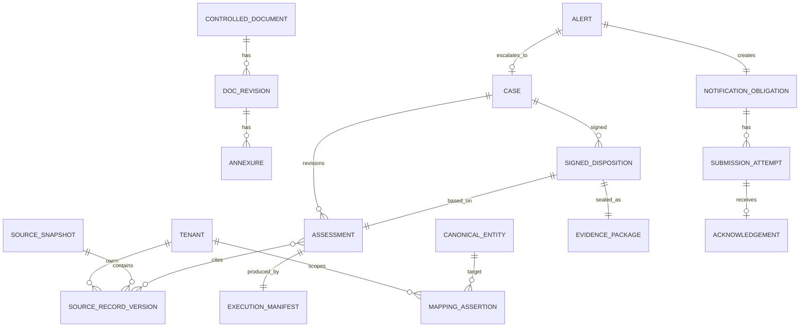

# 02 — Architecture (HLD)

Status legend used throughout: **[IMPL]** implemented in the prototype · **[SIM]** simulated/stubbed in the prototype · **[DESIGN]** proposed production behaviour, not built.

## 1. Shape: a modular monolith per regional cell, plus workers

The work is transactional, audit-heavy and moderate in volume: about 11,400 alerts and 2,050 reviewed cases a month, with bursts of 1,912 in 38 minutes (`13`). Six engineers have to build and run it. A **modular monolith** gives us one transactional database per cell, in-process module boundaries enforced by package rules and tests, and background workers for slow or external work. Microservices would add distributed consistency problems (outbox everywhere, cross-service tenant checks) without a scaling need.

**Regional cells** satisfy residency (`12`). Each cell has its own Postgres, object store and workers:
- **EU** (Amsterdam): T-AURA, T-NORDIA and other EU-clause tenants.
- **IN** (Gurugram region): T-VIRENT and other India-clause tenants; Kaveri and Sahyadri are hosted here for latency.
- **AMER**: US and Brazil tenants without clauses.

A thin **global control plane** holds only non-tenant data: the tenant→cell routing table, code/config release metadata and the vendor bulletin feed. No tenant evidence crosses cells.

```mermaid
flowchart LR
  subgraph Sources
    S1[SYS-01 ThermaTrace REST]:::ext
    S2[SYS-02 CryoSense MQTT]:::ext
    S3[SYS-03 Coldlink BMS Kafka]:::ext
    S4[SYS-04 Sentinel TMS CDC]:::ext
    S5[SYS-05 Tenant ERP SFTP]:::ext
    S6[SYS-06 Stability SharePoint]:::ext
    S7[SYS-07 Docuvault REST]:::ext
    S8[SYS-08 Contract Box]:::ext
    S9[SYS-09 Carrier EDI/CSV/fax]:::ext
  end
  subgraph CP[Global control plane - no tenant evidence]
    R[Tenant to cell routing]
    REL[Release / config registry]
    BUL[Vendor bulletin feed]
  end
  subgraph Cell[Regional cell: EU / IN / AMER]
    ING[Ingestion and source snapshots]
    ATT[Tenant attribution + quarantine]
    ER[Entity resolution + mapping approvals]
    DOC[Controlled evidence registry]
    POL[Temporal policy selection]
    TRI[Alert triage / closure policy]
    ASM[Assessment kernel]
    CASE[Case workflow + signatures]
    OBL[Notification obligations + timers]
    PREC[Tenant-scoped precedent store]
    PKG[Evidence package service]
    LLM[Optional LLM drafting - per-tenant route]
    AUD[(Audit log, append-only)]
    DB[(Postgres: bitemporal evidence, cases, outbox)]
    OBJ[(Object store, WORM 7y)]
  end
  Sources --> ING --> ATT --> ER --> ASM
  DOC --> POL --> ASM
  ASM --> TRI
  ASM --> CASE
  ING --> OBL
  CASE --> PKG --> OBJ
  PREC --> ASM
  ASM -. evidence only .-> LLM -. draft text .-> CASE
  CP --> Cell
  classDef ext fill:#eee,stroke:#999
```



## 2. Components and why each boundary exists

| Component | Responsibility | Why it is a separate boundary | Status |
|---|---|---|---|
| Ingestion & source snapshots | Pull/receive from the nine systems; store every source version immutably with `recorded_at`; snapshot telemetry windows at alert time | Sources are lossy: SYS-01 keeps raw data 30 days, SYS-03 never backfills (`11`). Without our own copy, AUD-2603 recurs | [IMPL] workbook ingest + versioning; [DESIGN] connectors |
| Tenant attribution | Assign tenant from source-native evidence; quarantine anything untagged or conflicting | BMS has no tenant tags (`11!R4`); guessing from site or product name risks cross-tenant leakage | [IMPL] prefix check + BMS flag; [DESIGN] quarantine queue |
| Entity resolution | (tenant, string) → canonical entity, using exact matches and **human-approved** mappings only | Mappings are reviewers' tacit knowledge (`07`) and need ownership, versioning and approval | [IMPL] |
| Controlled evidence registry | SOP revisions, annexures, stability studies, contracts and extracted facts, each versioned with provenance and a content hash | The question is always "which version", never "which document" (AUD-2603) | [IMPL] index-level; [DESIGN] content store + extraction with human verification |
| Temporal policy selection | Revision in force at a site on a local date; overlap → conflict | The hardest rule to get right, and the root of EXC-110490 | [IMPL] |
| Alert triage / closure policy | Close only demonstrably non-actionable alerts; everything else becomes a case | Keeps "closure" from becoming disguised release | [DESIGN]; the rules engine stays meanwhile |
| Assessment kernel | Builds a reproducible assessment (evidence, conflicts, abstentions, manifest) for a given valid time and knowledge cutoff | This is the replayable unit Dr Rao evaluates | [IMPL] |
| Case workflow | States, waits, leases, signatures, reopen | Human accountability lives here | [DESIGN] (`03` §4) |
| Notification obligations | Independent clock from alert receipt; durable timers; acknowledgement-based completion | INC-2502; it must keep running when the case workflow is blocked | [IMPL] in-memory reference; [DESIGN] DB + outbox |
| Precedent store | Prior signed cases **of the same tenant**, filtered before retrieval, and visible only as known at the cutoff | INC-2512; Cl.22 | [IMPL] lane history with knowledge gate; [DESIGN] search |
| Evidence package | Hashed bundle per assessment and per signature; WORM retention for 7 years | Board #3 | [IMPL] export/verify; [DESIGN] WORM |
| Optional LLM drafting | Summarise an assessment into reviewer prose; never decides; input = assessment JSON only | INC-2411, INC-2509 and the January pilot. Must be removable without loss of function | [DESIGN]; prototype route = NONE |
| Audit / observability | Append-only audit, structured logs, metrics | Inspection and the 3 a.m. operator | [IMPL] audit table; [DESIGN] metrics |

## 3. Evidence assessment sequence

```mermaid
sequenceDiagram
  participant SRC as Source (SYS-01..03)
  participant ING as Ingestion
  participant OBL as Obligations
  participant ASM as Assessment kernel
  participant TV as TenantView (store)
  participant CASE as Case workflow
  participant QA as QA reviewer
  SRC->>ING: alert reading (at-least-once)
  ING->>ING: dedupe by (source, source_msg_id); store source version
  ING->>OBL: register obligation(tenant, event, alert_received_at) [same transaction, outbox]
  ING->>ASM: assess(event, valid_at=excursion_start, cutoff=now)
  ASM->>TV: open view(principal, tenant) -- denied & audited if not authorised
  TV-->>ASM: tenant records as known at cutoff (SQL-filtered)
  ASM->>ASM: resolve product/sites/carrier; select SOP; check stability; telemetry; firmware
  ASM-->>CASE: assessment (id = content hash) READY_FOR_QA_REVIEW or ABSTAIN + human actions
  CASE->>QA: work item ordered by obligation deadline, then age
  QA->>CASE: resolve conflicts / approve mappings (new versions) -> reassess (new id, supersedes)
  QA->>CASE: sign disposition (expected_version, signature) -> package sealed
```

## 4. Degradation and outages

| Failure | Behaviour | Effect on regulatory clock |
|---|---|---|
| Telemetry source down / gap | Assessment marks TELEMETRY gap (blocking); no inference across gaps (EXC-110504) | None. The clock started at alert receipt |
| Docuvault / SharePoint down | Use the last registered version only if its `recorded_at` ≤ cutoff; otherwise abstain | None |
| Model provider down or sunset | Kernel and workflow are unaffected; drafting falls back to templates ("no-LLM" route is qualified) | None |
| Retrieval/precedent index down | Case proceeds with "precedents unavailable" stated in the assessment | None |
| Regional DB failover | Proposed RPO ≤ 5 min (sync replica in-region), RTO ≤ 1 h. Obligation timers are rebuilt from the table on start (`due_at` is data, not an in-memory timer) | Timers resume. Any obligation within T-6 h is escalated to a human on recovery |
| Our whole cell down | Regulatory Affairs runbook: manual register from the source alert feed. Obligations are reconciled on recovery against an independent alert count | The deadline does not move; breaches are reported, not hidden |
| Alert storm (INC-2502) | Storm grouping for triage display; one obligation per alert; per-tenant queues; EDF scheduling | Other tenants' 72 h obligations stay at the front (`test_storm_of_1912…`) |

Waiting on carrier data, lab results or document control **never pauses** a notification clock. No source in the pack permits pausing.

## 5. Versioning and delivery (summary; detail in `03` §7)

Everything that can change a conclusion is versioned and recorded in each assessment's `manifest`: code fingerprint, ruleset, config hashes (scope rules, lexicon, regimes, bulletins), source record versions, mapping assertions, and model route/version/parameters when used. Every behaviour-affecting change runs a **historical replay per tenant** and produces a diff report of assessments whose status or findings change. QA approves the report; the change then goes to shadow and canary. INC-2411 (31 tenants changed silently) cannot happen when the change must name the tenants whose replay diffs are non-empty.

## 6. Data and provenance (core relationships)



## 7. Tenant and regional controls

- **Before retrieval:** every repository call requires a `TenantView(principal, tenant)`; SQL filters by `tenant_code`. Shared reference data (facilities, contracts) is Kestrel-owned and readable by any tenant. Untenanted product aliases are not readable at all [IMPL].
- **Caches** live on the view object, so they are tenant-keyed by construction [IMPL]. Production uses Redis keys prefixed by tenant and cell [DESIGN].
- **Indexes and embeddings:** one index per tenant, stored in the tenant's cell, built only from that tenant's records. No cross-tenant model training or evaluation sets (Meridian Cl.22) [DESIGN].
- **Logs:** structured logs carry `tenant_code` and IDs, never evidence payloads. Log sinks are per cell [DESIGN].
- **Model inputs:** an assessment JSON for one tenant only. The route is chosen by tenant policy: `NONE` (T-VIRENT and the 6 API-prohibited tenants), `EU_ENDPOINT_ZERO_RETENTION` (T-AURA, T-NORDIA: Provider A/C EU), `ANY_ZERO_RETENTION`. Provider B is excluded: US-only, no zero-retention agreement, 30-day deprecation notice [DESIGN].
- **Signing:** policy per tenant from `12`: dual for T-VIRENT, Part 11 two-factor for T-PINNACLE, named QA Head for T-AURA, Responsável Técnico for T-CAMPOS [IMPL surfaced; DESIGN enforced].
- **Unattributed records** (e.g. BMS alerts without a TMS room mapping) go to an attribution queue and are never inferred from facility or product names [IMPL flag; DESIGN queue].

## 8. Diagrams for lifecycles

See `03_detailed_design_lld.md` §4 (case lifecycle) and §5 (notification lifecycle).

## 9. Cost and sizing (tab 13; prices from the procurement list `13!R33–38`)

**Volumes:** 11,400 alerts/month screened; 2,050 reach a human (`13!R5,R7`).

**Ceilings:** screening $0.06 × 11,400 = **$684**; reviewed $1.10 × 2,050 = **$2,255**; sum **$2,939**. The sum matches the CFO's "three thousand dollars a month" (B§4), so we read the ceilings as **additive sub-budgets**. *Ambiguity:* if the per-case ceiling were meant to include its screening, the budget would be $2,255. The design fits either reading.

| Route | When | Model / price | Tokens per call (assumption) | Per unit | Monthly |
|---|---|---|---|---|---|
| S0 screening, no LLM | every alert | none | 0 | $0 | **$0** |
| S1 screening, optional | if a screening summary is wanted | A-small $0.80/$4.00 per M | 1,500 in / 150 out | 1,500×0.8e-6 + 150×4e-6 = **$0.0018** | 11,400 × 0.0018 = $20.5 |
| R1 reviewed-case draft | cases with LLM route | A-large $3/$15 per M (EU endpoint for EU tenants) | 12,000 in / 1,200 out | 0.036 + 0.018 = **$0.054**; ×1.10 retries = $0.059 | 2,050 × 0.059 = **$121** |
| Retrieval | per case | embeddings $0.02/M; per-tenant index | 4,000 tok/case | $0.00008 | **$0.16** |
| Evaluation overhead | every behaviour change: replay ~2,000 historical cases on R1 | A-large | as R1 | $108 per replay | 4/month cap = **$432** |
| **Total (S0 + R1 + retrieval + eval)** | | | | | **≈ $553/month** (≈ $575 with S1) of $2,939 |

Per-unit checks: screening $0–$0.0018 against the $0.06 ceiling; reviewed $0.059 against $1.10. Both are comfortably inside.

**Quiet Sunday:** pay-per-use routes cost about $0 when idle. The kernel itself runs on the cell's always-on app tier (capital line, below).

**Self-hosted where APIs are prohibited:** g5.12xlarge $5.67/h × 730 h = **$4,139/month** for one always-on instance, which exceeds the whole model budget. Even 4 h/day is $690/month, and it is paid on quiet days too. Hence **"no LLM" is the supported route** for T-VIRENT and the 6 API-prohibited tenants. The value is in evidence assembly, which is deterministic. Drafting uses templates filled from the assessment.

**Capital line (not funded from the ceiling, sized here):**
- **Readings:** 10 M/day × ~40 B compressed columnar ≈ 0.4 GB/day ≈ 146 GB/year. Whether to keep all readings for 7 years is a policy decision. The **mandatory** part is the evidence window per alert (e.g. ±24 h for the logger: ~600 readings, < 50 KB).
- **Evidence packages:** ~11,400 assessments/month × ~0.3 MB (JSON + series window + cited records) ≈ 3.4 GB/month ≈ **290 GB over 7 years** per platform, before re-assessments (assume ×1.5 → ~430 GB). Signed-document snapshots (SOP/stability PDFs, de-duplicated by content hash) dominate: the 11,040 stability PDFs and 4,312 SOPs at an assumed ~2 MB average ≈ 31 GB once, plus revisions.
- **Indexing:** per-tenant indexes for 2,050 cases/month are trivial in size.

All of these are assumptions to confirm with the platform team.

**Money that is not savings:**
- Destroyed product is **$7,200 per destroy decision** ($19.4 M / 2,700, `13!R20`), not the $84,000 average consignment value. Audit's 32% salvageable estimate is ≈ $6.2 M of *potential* avoided loss, and only if evidence arrives in time.
- Released reviewer time (median 96 min/case, `13!R11`) is **capacity**, not guaranteed cash. It should first absorb the evidence-quality work (mapping approvals, SOP conflict resolution) that this design deliberately creates.
