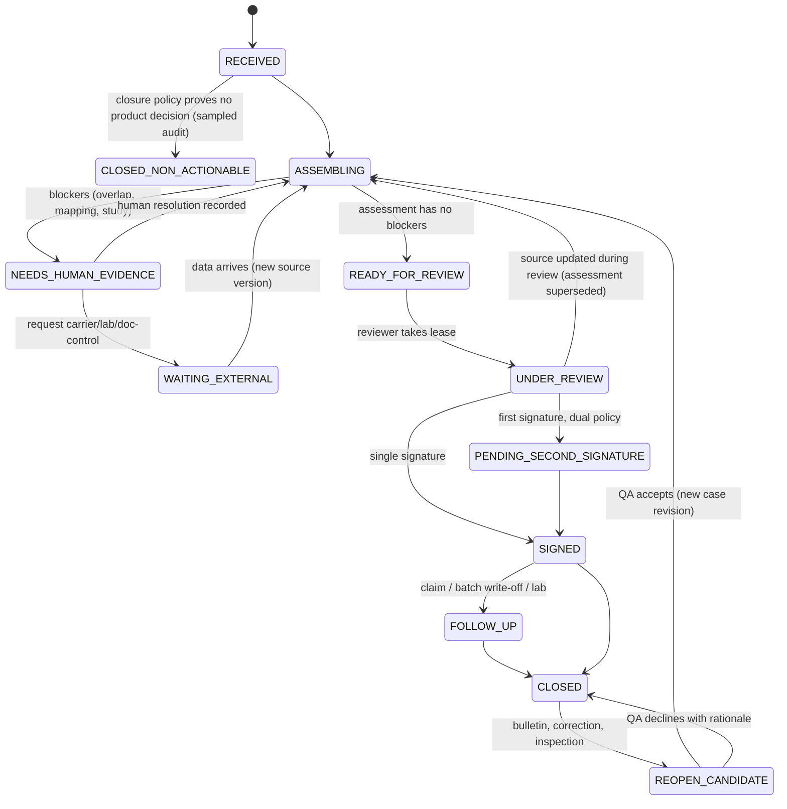
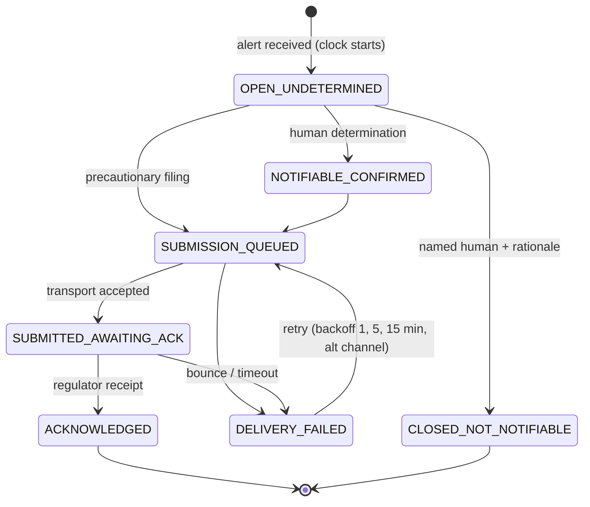

# Deliverable 2: Detailed design (low-level design)

Legend: **[IMPL]** in prototype · **[SIM]** stubbed · **[DESIGN]** proposed.

## 1. Time model

| Concept | Definition | Where |
|---|---|---|
| **Valid time** | When a fact or policy applied in the world. SOP revisions: `[effective_from, effective_to)` of **site-local calendar dates**. Contracts: the same convention, on the governing-law date. An excursion's valid instant is `excursion_start_utc` | `temporal.py`, `policy_sop.py` [IMPL] |
| **Recorded (knowledge) time** | When *this system* learned a version (`source_record_version.recorded_at`, `mapping_assertion.recorded_at`). Never inferred from valid time | `store.py` [IMPL] |
| **Receipt time** | `alert_ts_utc`: when the reading reached Sentinel. Starts the notification clock (`00!R43`) | `obligations.py` [IMPL] |
| **Interval convention** | Half-open. Evidence: 115 hand-overs in `05` have `effective_to == next effective_from`. A blank `effective_to` (or "evergreen") is open | [IMPL] |
| **Date-only policies & timezone** | The local date at the **governed site** decides (Kundli SOP → Asia/Kolkata). If the site is unresolved or its timezone is untrusted (MEM-CS-02 confirmed wrong, IND-CS-01 suspect), every plausible date between UTC−12 and UTC+14 is evaluated, and a differing selection is `BOUNDARY_AMBIGUOUS` (blocking) | [IMPL] |
| **Two questions** | *"What did we know then?"* = strict mode: only versions with `recorded_at ≤ cutoff`. *"What do we conclude now about then?"* = valid time at the excursion, knowledge at a later cutoff | [IMPL] `mode=STRICT/RECONSTRUCTED` |
| **Reconstructed mode (pack limitation)** | The pack has no recorded-time history, so its snapshot is treated as a backfilled baseline. Anything recorded *after* the baseline (corrections, mappings) is visible only if `recorded_at ≤ cutoff`. Domain knowledge dates gate further: alias `confirmed_on`, bulletin `known_from`, precedent signature time, product-master `last_updated` (flagged when after the alert). Every reconstructed assessment carries `KNOWLEDGE_TIME_RECONSTRUCTED` | [IMPL] |
| **Supersession** | New versions append; nothing is updated or deleted (DB triggers). A signed disposition references an assessment ID, which references exact source versions; later corrections produce a new assessment with `supersedes` and a `change_from_superseded` diff | [IMPL] |
| **Conflicts** | Two in-force revisions, a master vs study limit, an ambiguous identifier, or attribution disagreement → BLOCKING finding naming every candidate. No ranking, no "latest row wins" | [IMPL] |

### Worked example: an "as at a date" query

Every question has two dates, and the system always asks for both:

- **valid date:** which SOP revision applied *on 28 July 2026 at the Kundli site*?
- **knowledge date:** what did we *know* about that *as at 28 July 06:31 UTC* (the alert), or as at today?

**Step 1: knowledge time.** Take, for each record, the latest version this system had recorded by the cutoff. This is the query the prototype runs ([`store.py`](../../src/kccs_evidence/store.py) `records()`). The tenant filter is in the SQL, so another tenant's rows are never read:

```sql
SELECT v.* FROM source_record_version v
WHERE v.sheet = '05_SOP_Index'
  AND v.tenant_code = 'T-KAVERI'                       -- isolation before retrieval
  AND v.recorded_at <= :knowledge_cutoff               -- "as we knew it then"
  AND v.version = (SELECT MAX(w.version) FROM source_record_version w
                   WHERE w.sheet = v.sheet AND w.record_key = v.record_key
                     AND w.recorded_at <= :knowledge_cutoff);
```

**Step 2: valid time.** Convert the excursion instant to the governed site's local date, then keep each revision whose half-open interval contains it: `effective_from <= local_date < effective_to` (a blank `effective_to` is open), in [`temporal.py`](../../src/kccs_evidence/temporal.py) and [`policy_sop.py`](../../src/kccs_evidence/policy_sop.py).

**Step 3: decide.** Exactly one revision means it is selected. None means `NONE_IN_FORCE` (blocking). Two or more means `CONFLICT_OVERLAPPING_REVISIONS`, a blocking conflict that names every candidate; the system never picks one.

**Applied to EXC-107133:** excursion 2026-07-28 06:14 UTC is 28 July in Asia/Kolkata. SOP-KAV-9392 Rev 02 `[2025-09-01, 2026-08-31)` and Rev 03 `[2026-05-16, open)` both contain that date, so the result is `CONFLICT_OVERLAPPING_REVISIONS` with both listed. Run it yourself:

```bash
kccs-evidence assess --db artifacts/my.sqlite --tenant T-KAVERI --event EXC-107133 --knowledge-cutoff alert                  # as known at the alert
kccs-evidence assess --db artifacts/my.sqlite --tenant T-KAVERI --event EXC-107133 --knowledge-cutoff 2026-09-14T23:59:00Z   # as known later
```

The two answers get different assessment IDs, and the first one never changes, even after later corrections. This is what lets an inspector ask "what did you know when you signed?" years later (AUD-2603).

## 2. Data model (production, Postgres per cell)

Conventions: every tenant-scoped table has `tenant_code NOT NULL` as the leading column of its primary key or index. Row-level security uses a `app.tenant` session variable as a second line of defence behind the application `TenantView`. The prototype's SQLite schema (`store.py`) implements the starred (★) tables.

| Table | Key / important columns | Constraints & indexes |
|---|---|---|
| `tenant` | `tenant_code` PK, `cell`, `residency`, `model_route`, `signature_policy_id`, `output_languages[]`, `notification_regime_id` | route ∈ {NONE, EU_ZR, ANY_ZR}; changes versioned in `tenant_policy_version` |
| `tenant_policy_version` | (`tenant_code`, `version`) PK, `valid_from`, `recorded_at`, `policy_json`, `approved_by` | append-only |
| ★`source_snapshot` | `snapshot_id` PK, `source_system`, `file_sha256`/`batch_id`, `recorded_at` | |
| ★`source_record_version` | (`sheet/source`, `record_key`, `version`) PK, `tenant_code` NULL only for shared/unattributed, `payload_json`, `row_hash`, `recorded_at`, `change_kind` {INGEST, CORRECTION}, `actor`, `reason` | UPDATE/DELETE trigger → abort; idx (`source`, `tenant_code`, `recorded_at`) |
| `canonical_entity` | (`tenant_code`, `kind`, `entity_id`) PK; kind ∈ PRODUCT_PRESENTATION, FACILITY_SITE (shared), CARRIER_LEGAL_ENTITY (shared) | products are tenant-scoped even when GTINs match across tenants |
| ★`mapping_assertion` | `assertion_id` PK, `tenant_code` (NULL for Kestrel-owned kinds), `kind`, `source_string`, `canonical_id`, `decision` {APPROVED, REJECTED}, `actor`, `recorded_at`, `evidence_ref` | unique (`tenant_code`, `kind`, norm(`source_string`), `recorded_at`); latest decision wins *as of cutoff* |
| `alias_observation` | imported `07` rows, `attribution` {UNATTRIBUTED, TENANT}, `confirmed_on` | product rows UNATTRIBUTED are unreadable by policy |
| `product_presentation` | (`tenant_code`, `product_id`) PK, `presentation` {PEN, VIAL, PFS,…}, `strength`, `gtin`, `sku`, `spec_low_c`, `spec_high_c`, valid interval | spec changes are new versions (`00!R34`) |
| `facility_site` | `site_code` PK, `country`, `iana_tz`, `tz_status` {TRUSTED, SUSPECT, WRONG}, `gmp_licences[]` | |
| `carrier_legal_entity` / `carrier_contract` | `contract_id` PK, `legal_entity_id`, `[effective_from, effective_to)`, `cold_chain_clause`, `claim_window_days`, `claim_trigger` | amendments as `contract_amendment` rows |
| `shipment` / `leg` | (`tenant_code`, `shipment_ref`) PK; `leg_no`, carrier legal entity per **leg** (EXC-110581) | |
| `batch`, `pallet_exposure` | (`tenant_code`, `batch_id`); per-pallet exposure intervals | not in pack → cumulative checks abstain |
| `sensor`, `firmware_build`, `calibration_bulletin` | bulletin: `firmware`, `direction`, `magnitude_min/max`, `exact_correction_known`, `known_from` | drives reopen candidates |
| `controlled_document` / `doc_revision` / `annexure` | (`tenant_code`, `doc_id`, `revision`) PK; `[from,to)`, `scope_rule_id`, `format`, `content_sha256`, `extracted_limits_json` + `verified_by` | overlaps allowed in data and **detected** at query time |
| `stability_study` | (`tenant_code`, `study_ref`) PK, `presentation`, `study_type`, `readability`, `permitted_excursion` (only if verified), `content_sha256` | owner = `tenant_code`, never the path |
| `alert` | (`tenant_code`, `event_id`) PK, `source_msg_id` unique per source, `alert_received_at`, `excursion_start`, aggregates | dedupe key (`source_system`, `source_msg_id`) |
| `case` | (`tenant_code`, `case_id`) PK, `state`, `version` (optimistic lock), `lease_holder`, `lease_until` | |
| ★`assessment` | `assessment_id` = content hash, `case_id`, `valid_at`, `knowledge_cutoff`, `supersedes`, `payload`, `payload_sha256` | immutable |
| `signed_disposition` | `signature_id` PK, `case_id`, `assessment_id`, `disposition`, `signer`, `signature_method`, `signed_at`, `second_signature_id` | immutable; reopen never edits |
| `notification_obligation` | (`tenant_code`, `event_id`) PK, `clock_start`, `due_at`, `regime_version`, `state`, `version` | `due_at` written once; idx (`state`, `due_at`) |
| `submission_attempt` / `acknowledgement` | attempt → transport result; ack with regulator reference | only an ack satisfies |
| `evidence_package` | `package_digest` PK, `assessment_id`/`signature_id`, `object_uri` (WORM), `retention_until` | |
| ★`audit_event` | seq, at, actor, tenant, action, target, outcome, detail | append-only, exported daily to WORM |
| `execution_manifest` | embedded in each assessment: code fingerprint, ruleset, config hashes, cited source versions, model route/version/params, stubs | |
| `outbox` | `id`, `aggregate`, `type`, `payload`, `created_at`, `dispatched_at` | written in the same transaction as the state change |

## 3. Interfaces (representative contracts)

All endpoints require an authenticated principal with tenant scopes. They carry `X-Tenant`, which must be in scope or the request returns **403 + audit** (the existence of other tenants' records is never revealed; unknown IDs return 404). Mutations take an `Idempotency-Key` and, where they change state, an `expected_version` (409 on mismatch). Retryable errors: 429/503 with `Retry-After`. All responses include `schema_version`.

```http
POST /v1/alerts                      # ingest an alert [DESIGN]; prototype: `kccs-evidence ingest`
Idempotency-Key: SYS-02:<source_msg_id>
{ "tenant_code":"T-KAVERI", "source_system":"SYS-01", "source_msg_id":"...", "event_id":"EXC-107133",
  "alert_received_at":"2026-07-28T06:31:00Z", "excursion_start":"2026-07-28T06:14:00Z", "excursion_end":"...",
  "logger":{"id":"LG-40843","vendor":"ThermaTrace","fw":"TT-2.15.0"}, "aggregates":{"min_c":5.4,"max_c":11.2,"duration_min":15},
  "refs_as_received":{"product":"08901234500035","origin":"Bhiwandi Hub","dest":"Kundli Pharma Store","carrier":"Tapti Exp Cargo"} }
→ 201 {"event_id":..., "obligation":{"due_at":"...","state":"OPEN_UNDETERMINED"}, "attribution":"NATIVE|DERIVED|QUARANTINED"}
→ 200 same body on replay of the same Idempotency-Key; 422 on invalid timestamps (no timezone) or unknown tenant
```

```http
POST /v1/tenants/{t}/resolve         # [IMPL] resolution.py
{ "kind":"PRODUCT", "value":"08901234500035", "knowledge_cutoff":"2026-07-28T06:31:00Z" }
→ 200 {"status":"RESOLVED|RESOLVED_PROVISIONAL|AMBIGUOUS|UNRESOLVED|MISSING_INPUT","resolved_id":"02_Product_Master!R57",
       "basis":"EXACT_GTIN","candidates":[...],"findings":[...]}
POST /v1/tenants/{t}/mappings        # human approval; role QA_MAPPING_APPROVER; append-only
{ "kind":"FACILITY","source_string":"F00231","canonical_id":"BLR-CS-02","decision":"APPROVED","evidence_ref":"07!R5" }
```

```http
GET /v1/tenants/{t}/evidence?event=EXC-107133&valid_at=2026-07-28T06:14Z&knowledge_cutoff=2026-07-28T06:31Z&mode=RECONSTRUCTED
→ 200 { "sop_origin":[{"doc_id":"SOP-KAV-9392","status":"CONFLICT_OVERLAPPING_REVISIONS","in_force":["Rev 02","Rev 03"]}],
        "stability":{"status":"CANDIDATE_ONLY", ...}, "time_semantics":{...} }
```

```http
POST /v1/tenants/{t}/assessments     # [IMPL] assess_and_store; idempotent by content hash
{ "event_id":"EXC-107133", "knowledge_cutoff":"alert|now|<ISO>", "mode":"RECONSTRUCTED|STRICT" }
→ 201 new / 200 existing  { "assessment_id":"ASM-…", "disposition_evidence_status":"ABSTAIN_BLOCKING_EVIDENCE_GAPS",
        "blocking_reasons":[...], "required_human_actions":[...], "manifest":{...}, "supersedes":"ASM-…?" }
```

```http
POST /v1/tenants/{t}/cases/{case}/decisions          # [DESIGN]
{ "expected_version":7, "assessment_id":"ASM-…", "disposition":"RELEASE_WITH_NOTE", "rationale":"…",
  "signature":{"method":"PART11_2FA","assertion":"…"} }
Guards: assessment is the case's latest; status READY_FOR_QA_REVIEW OR every blocking finding has a recorded human
resolution; signer satisfies the tenant signature policy; dual → state PENDING_SECOND_SIGNATURE.
→ 201 {"signature_id":…, "package_digest":…}   409 stale version / newer assessment   403 signer not authorised
POST /v1/tenants/{t}/cases/{case}/reopen              # [DESIGN]
{ "expected_version":9, "trigger":"BULLETIN:TT-CB-114", "assessment_id":"ASM-new" }
→ original signature + package untouched; new case revision with link; liability follow-up created if invoiced (INC-2506)
GET  /v1/tenants/{t}/packages/{assessment_or_signature_id}   # [IMPL] export_package / verify_package
→ 200 zip: assessment.json, source_records.json, audit_trail.json, MANIFEST.json (sha256 per file + digest)
POST /v1/tenants/{t}/obligations/{event}/transitions   # [IMPL] ObligationLedger.transition
{ "expected_version":3, "to":"SUBMISSION_QUEUED|SUBMITTED_AWAITING_ACK|DELIVERY_FAILED|ACKNOWLEDGED|NOTIFIABLE_CONFIRMED|CLOSED_NOT_NOTIFIABLE",
  "note":"…", "ack_reference":"…" }
→ 409 version conflict; 422 illegal transition; CLOSED_NOT_NOTIFIABLE requires a named human + rationale
```

## 4. Case workflow (disposition) [DESIGN; assessment states IMPL]



| State | Trigger | Guards | Action | Next | Timeout / escalation (proposed) | Audit event |
|---|---|---|---|---|---|---|
| RECEIVED | alert ingested | tenant attributed | create obligation (same txn); assess | ASSEMBLING / CLOSED_NON_ACTIONABLE | — | ALERT_RECEIVED |
| RECEIVED | closure policy | closure reason verifiable (duplicate with same physical excursion key; no product in room per TMS) and **no** product-exposure uncertainty | close, 5% blind audit sample | CLOSED_NON_ACTIONABLE | — | ALERT_CLOSED_NON_ACTIONABLE |
| ASSEMBLING | assessment built | — | store assessment | READY_FOR_REVIEW / NEEDS_HUMAN_EVIDENCE | 15 min to first assessment | ASSESSMENT_BUILD |
| NEEDS_HUMAN_EVIDENCE | QA resolves conflict / approves mapping | role-appropriate; resolution cites evidence | append mapping/resolution; reassess | ASSEMBLING | 1 business day → QA lead | HUMAN_EVIDENCE_RESOLVED |
| NEEDS_HUMAN_EVIDENCE | request external data | — | outbox request (carrier/lab/doc-control) | WAITING_EXTERNAL | — | EXTERNAL_REQUESTED |
| WAITING_EXTERNAL | data arrives | new source version | reassess | ASSEMBLING | carrier 24 h, lab per SLA, then QA lead. **Notification clock unaffected** | EXTERNAL_RECEIVED |
| READY_FOR_REVIEW | reviewer claims | lease free; reviewer authorised for tenant | lease 30 min, renewable | UNDER_REVIEW | lease expiry → back to queue | LEASE_ACQUIRED |
| UNDER_REVIEW | concurrent action | `expected_version` matches | — | — | 409 to the loser | CONFLICT_REJECTED |
| UNDER_REVIEW | source update during review | — | supersede assessment; signing against the old ID returns 409 | ASSEMBLING | — | ASSESSMENT_SUPERSEDED |
| UNDER_REVIEW | sign | signer policy; latest assessment; blockers resolved | seal package (WORM) | SIGNED / PENDING_SECOND_SIGNATURE | — | DISPOSITION_SIGNED |
| PENDING_SECOND_SIGNATURE | second signer | different person; role per tenant | seal | SIGNED | 8 h → corporate QA | SECOND_SIGNATURE |
| SIGNED | liability follow-up | carrier resolved & contract clause | create claim task (claim window) | FOLLOW_UP | claim window − 3 days | CLAIM_OPENED |
| CLOSED | bulletin / correction | knowledge-time diff adds firmware/limit findings | create reopen candidate; **original signature untouched** | REOPEN_CANDIDATE | 5 business days | REOPEN_CANDIDATE |
| REOPEN_CANDIDATE | QA accepts | — | new case revision; withdraw invoices if carrier-billed (INC-2506) | ASSEMBLING | — | CASE_REOPENED |

## 5. Notification lifecycle (independent) [IMPL in `obligations.py`]



Escalation (proposed): an open obligation at T−24 h goes to the Regulatory Affairs queue; at T−6 h it pages the on-call RA lead; at T−1 h it pages the RA manager plus a precautionary filing prompt. If `due_at` cannot be computed (next-business-day policy incomplete), it escalates immediately. A queued email or transport 250-OK is **not** completion.

## 6. Reliability

- **At-least-once ingest, idempotent effects:** dedupe on (`source_system`, `source_msg_id`); SYS-02 duplicates after a reboot (`11!R3`) collapse. Assessment IDs are content hashes, and obligation registration is keyed by (`tenant`, `event`) [IMPL].
- **Outbox:** state change and outbox row in one transaction; a dispatcher delivers with retries; consumers are idempotent [DESIGN].
- **Durable timers:** `due_at` and escalation times are columns; a scheduler polls `state IN open AND next_escalation_at <= now()` with `FOR UPDATE SKIP LOCKED`. After a crash it simply resumes [DESIGN].
- **Backpressure & noisy tenants:** per-tenant queues with weighted fair dequeue; storm detector groups alerts by (site, room, 10-min window) **for display only**; obligations stay one per alert [IMPL test].
- **Deadline-aware scheduling:** reviewer worklist ordered by obligation `due_at`, then case age. Policy-incomplete obligations come first [IMPL `at_risk`].
- **Fail-closed:** missing tenant scope → deny; unknown attribution → quarantine; evidence service unavailable → abstain, never a default "pass" [IMPL].
- **Manual operation:** if model, retrieval or kernel are down, reviewers work from source systems as today. The obligation ledger has a manual entry UI and paper-runbook reconciliation [DESIGN].
- **Recovery:** proposed RPO 5 min / RTO 1 h per cell, not demonstrated. WORM package store is cross-zone replicated within the cell's region. After recovery: replay ingestion from source offsets (Kafka/CDC), then reconcile obligation counts against the source alert count per tenant per hour [DESIGN].

## 7. Versioning and delivery pipeline [DESIGN; manifest IMPL]

| Artefact | Versioned how |
|---|---|
| Application code | git SHA + package fingerprint in the manifest (`code_sha256`) |
| DB schema | migration number (`store_schema_version`); forward-only, expand/contract |
| Entity mappings | `mapping_assertion` rows (actor, recorded_at) |
| Rules, tenant policy, scope interpretations, bulletins, regimes | JSON config with `version` + sha256 in the manifest; QA-approved PR |
| Documents & extracted facts | `doc_revision.content_sha256`; extracted limits carry `verified_by` |
| Retrieval/index config | index build ID per tenant (embedding model, chunking, filter) |
| Prompt templates, model + parameters | template hash, provider/model/version, temperature; per-tenant route |
| Evaluation datasets & scoring | frozen replay sets per tenant (hash), scoring policy version |

Pipeline:
1. CI: lint, unit, synthetic-fixture tests, isolation suite.
2. **Historical replay per tenant** against frozen sets, with a diff report (status/finding changes per tenant). Any tenant with a non-empty diff must be named in the change request.
3. **QA approval** of the diff by Dr Rao's delegate.
4. **Shadow** (outputs stored, not shown) for 1 week.
5. **Canary** to one tenant (proposed 3 days).
6. Progressive rollout by cell.
7. **Rollback** by flipping the config/code version pointer; assessments made under the old version remain valid records.
8. **Emergency disable** per tenant and per route (model off → template route; kernel off → current manual process).
9. **Qualified fallback:** the no-LLM route is always qualified, so a model sunset (INC-2509) never forces an unqualified model.
10. **Model sunset plan:** accept only providers with ≥ 6 months' notice (A, C). Maintain a pre-qualified second model; re-qualification uses the same replay harness.
11. **Dependencies:** pinned (`pyproject.toml`), with a scanner in CI.
